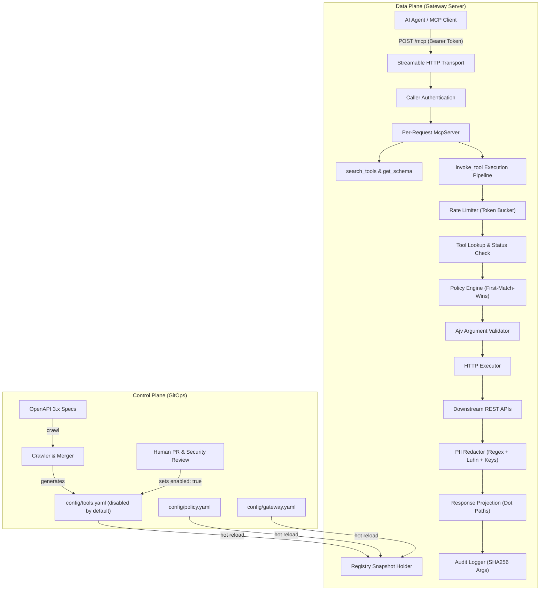

# UberGate

Inspired by [Uber Engineering's "Designing MCP Gateway"](https://www.uber.com/gb/en/blog/designing-mcp-gateway/), UberGate is an independent implementation and is not Uber's code. It is an open, governed API-to-MCP gateway that automatically crawls existing REST APIs described by OpenAPI specifications, generates tools that are **disabled by default**, and serves them to AI agents over standard MCP (Model Context Protocol). Cross-cutting concerns—caller authentication, fine-grained RBAC/policy by actor type and risk tier, rate limiting, PII redaction, audit logging, and token-efficient progressive discovery (`search_tools`, `get_schema`, `invoke_tool`)—are enforced in a centralized gateway layer so backend engineering teams never hand-write or insecurely expose MCP wrappers.

> [!NOTE]
> Tools configuration changes are reviewed by [`@0xPsyop`](.github/CODEOWNERS).

---

## Why UberGate?

As enterprises connect LLM agents to internal infrastructure, exposing internal services presents three critical challenges described in Uber's architecture:

1. **Catalog Context Bloat**: A conventional `tools/list` response grows with the number and size of endpoint schemas. In the generated 200-endpoint scenario measured below, the initial catalog is estimated at 19,171 tokens using a character-based heuristic; the same catalog is synthetic, not a production API.
2. **Accidental Exposure & Lack of Governance**: Auto-generating tools directly to agents risks unintentional invocation of write or destructive endpoints, leaks raw PII (social security numbers, credit cards, phones) into model prompts, and lacks per-caller authorization.
3. **Control Plane / Data Plane Decoupling**: Hand-coding MCP servers per team creates maintenance sprawl and inconsistent security controls. A declarative, GitOps-driven control plane ensures that discovery does not mean exposure: tools require human review in pull requests to be enabled.

---

## Token-size measurement

Run `npm run benchmark:tokens` to reproduce these measurements. The script serializes the tool definitions and request/response payloads as JSON, then estimates tokens as `ceil(UTF-16 character count / 4)`. This is a rough estimate, not output from a model tokenizer. Full-flow totals include the initial `tools/list`, tool-call requests, and tool-call responses. The `demo.getUser` invocation executes against the local demo API; the 200-endpoint catalog is generated synthetic OpenAPI.

| Scenario | Enabled tools | Conventional catalog | Progressive catalog | Conventional full flow | Progressive full flow | Estimated full-flow change |
| :--- | ---: | ---: | ---: | ---: | ---: | ---: |
| Demo API configuration | 6 | 1,502 chars / 376 tokens | 876 chars / 219 tokens | 1,759 chars / 440 tokens | 2,413 chars / 604 tokens | 37.3% more |
| Synthetic OpenAPI catalog | 200 | 76,681 chars / 19,171 tokens | 876 chars / 219 tokens | 76,938 chars / 19,235 tokens | 3,315 chars / 829 tokens | 95.7% fewer |

The demo API catalog is small enough that the full progressive flow costs more in this estimate. The synthetic result shows the effect of catalog size; it should not be read as a measurement of a real API or a model's exact tokenization.

---

## Architecture



---

## Quickstart

### 1. Install & Configure

```bash
# Clone and install dependencies
git clone https://github.com/0xPsyop/ubergate.git
cd ubergate
npm install

# Setup development environment variables
cp .env.example .env
```

### 2. Start the Demo API and UberGate

In terminal 1 (Demo API with fake PII data on port 4000):

```bash
npm run demo-api
```

In terminal 2 (UberGate on port 3000):

```bash
npm run dev
```

### 3. Connect via MCP Client (or curl)

Send an authenticated JSON-RPC request to `http://localhost:3000/mcp`:

```bash
curl -X POST http://localhost:3000/mcp \
  -H "Content-Type: application/json" \
  -H "Authorization: Bearer dev-alice-token" \
  -d '{
    "jsonrpc": "2.0",
    "id": 1,
    "method": "tools/call",
    "params": {
      "name": "search_tools",
      "arguments": { "query": "get user" }
    }
  }'
```

#### Connecting from Claude Desktop / Cursor

Configure your MCP client settings with HTTP transport and authorization headers:

```json
{
  "mcpServers": {
    "gateway": {
      "url": "http://localhost:3000/mcp",
      "headers": {
        "Authorization": "Bearer dev-alice-token"
      }
    }
  }
}
```

---

## Crawl -> PR -> Enable Workflow

1. **Crawl an OpenAPI Specification:**
   Run the crawler against any OpenAPI 3.x spec file:

   ```bash
   npm run crawl:demo -- --owner @team-demo
   ```

   A newly discovered tool is merged with `enabled: false` and `needs_review: false`. If an existing tool has the same ID but a different `source_hash`, the merge resets it to `enabled: false` and sets `needs_review: true`; unchanged tools preserve their existing human edits and review state.

2. **Open a Pull Request:**
   A human engineer reviews the endpoint and enables it explicitly in Git:

   ```diff
   --- a/config/tools.yaml
   +++ b/config/tools.yaml
      - id: demo.getUser
        server: demo
        description: Get a user by ID
        risk: read
        owner: "@team-demo"
   -    enabled: false
   +    enabled: true
   ```

3. **Continuous Enforcement & Change Detection:**
   If upstream API contracts change, re-crawling updates the `source_hash`, automatically resets `enabled: false`, and flags `needs_review: true`, requiring re-approval before exposure.

---

## Governance: Policy & PII Redaction

- **Centralized Policy Engine (`config/policy.yaml`)**:
  Rules follow first-match-wins semantics over caller type (`human`, `service`, `agent`), tool risk tier (`read`, `write`, `destructive`), glob tool patterns, and required OAuth scopes. For instance, `helper-agent` can read and write, but is strictly denied destructive tools like `demo.deleteUser`.
- **Automatic PII Redaction (`config/gateway.yaml`)**:
  Responses are inspected prior to projection:
  - **Pattern Redaction**: Emails, phone numbers (US and international), SSNs (`\d{3}-\d{2}-\d{4}`), and 13–19 digit credit cards validated against the **Luhn algorithm**. Non-card numeric identifiers (like barcodes) are safely preserved.
  - **Key-Based Redaction**: Case-insensitive matching replaces sensitive values for keys like `password`, `ssn`, `token`, `secret`, `api_key`, and `cardNumber`.
- **Zero Raw PII in Audit Logs**:
  Tool arguments and payloads are never logged raw. Only a SHA-256 hash of the arguments is stored in `logs/audit.jsonl`.

---

## What I Intentionally Cut

To preserve clean separation of concerns and maintain a focused showcase, the following advanced capabilities are deliberately deferred to future work:

- Distributed catalog crawling & multi-region sync
- gRPC / Protocol Buffers & Apache Thrift protocol translation
- Native MCP server reverse proxying
- Third-party token exchange & dynamic OAuth2 authorization flows
- Prompt-injection scanning of downstream tool responses

Read the comprehensive technical discussion in [`docs/roadmap.md`](docs/roadmap.md) and design rationales in [`docs/design-decisions.md`](docs/design-decisions.md).

---

## License

MIT © 2026
