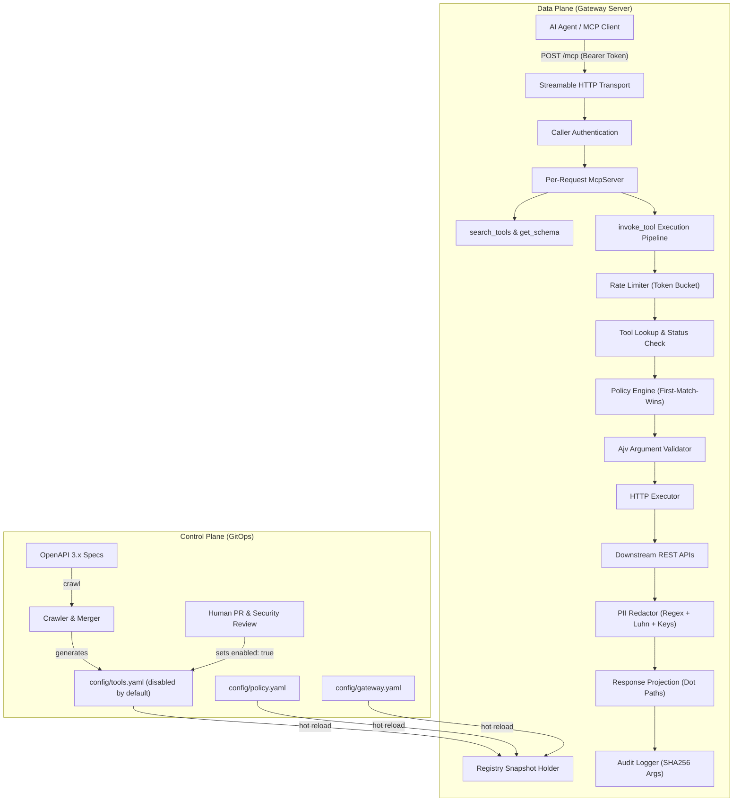

# MCP Gateway

<!-- demo.gif -->

**MCP Gateway** is an open, governed API-to-MCP gateway inspired by Uber Engineering's *"Designing MCP Gateway"*. It automatically crawls existing REST APIs described by OpenAPI specifications, generates tools that are **disabled by default**, and serves them to AI agents over standard MCP (Model Context Protocol). Cross-cutting concerns—caller authentication, fine-grained RBAC/policy by actor type and risk tier, rate limiting, PII redaction, audit logging, and token-efficient progressive discovery (`search_tools`, `get_schema`, `invoke_tool`)—are enforced in a centralized gateway layer so backend engineering teams never hand-write or insecurely expose MCP wrappers.

> [!NOTE]
> Please update `.github/CODEOWNERS` with your organization or GitHub username (`@YOUR_GITHUB_USERNAME`) to enforce code reviews on tools configuration changes.

---

## Why MCP Gateway?

As enterprises connect LLM agents to internal infrastructure, exposing internal services presents three critical challenges described in Uber's architecture:

1. **Catalog Context Bloat**: Exposing hundreds of REST endpoints directly via conventional MCP `tools/list` floods LLM context windows (consuming 15,000+ tokens before the agent even begins reasoning), degrading inference speed and agent accuracy.
2. **Accidental Exposure & Lack of Governance**: Auto-generating tools directly to agents risks unintentional invocation of write or destructive endpoints, leaks raw PII (social security numbers, credit cards, phones) into model prompts, and lacks per-caller authorization.
3. **Control Plane / Data Plane Decoupling**: Hand-coding MCP servers per team creates maintenance sprawl and inconsistent security controls. A declarative, GitOps-driven control plane ensures that discovery does not mean exposure: tools require human review in pull requests to be enabled.

---

## Architecture



---

## 60-Second Quickstart

### 1. Install & Configure

```bash
# Clone and install dependencies
git clone https://github.com/your-org/mcp-gateway.git
cd mcp-gateway
npm install

# Setup development environment variables
cp .env.example .env
```

### 2. Start the Demo API and Gateway

In terminal 1 (Demo API with fake PII data on port 4000):
```bash
npm run demo-api
```

In terminal 2 (MCP Gateway on port 3000):
```bash
npm run dev
```

### 3. Connect via MCP Client (or curl)

Send an authenticated JSON-RPC request to `http://localhost:3000/mcp`:

```bash
curl -X POST http://localhost:3000/mcp \
  -H "Content-Type: application/json" \
  -H "Authorization: Bearer dev-alice-token" \
  -d '{
    "jsonrpc": "2.0",
    "id": 1,
    "method": "tools/call",
    "params": {
      "name": "search_tools",
      "arguments": { "query": "get user" }
    }
  }'
```

#### Connecting from Claude Desktop / Cursor
Configure your MCP client settings with HTTP transport and authorization headers:

```json
{
  "mcpServers": {
    "gateway": {
      "url": "http://localhost:3000/mcp",
      "headers": {
        "Authorization": "Bearer dev-alice-token"
      }
    }
  }
}
```

---

## Crawl -> PR -> Enable Workflow

1. **Crawl an OpenAPI Specification:**
   Run the crawler against any OpenAPI 3.x spec file:
   ```bash
   npm run crawl:demo -- --owner @team-demo
   ```
   All generated tools are created with `enabled: false` and `needs_review: false`.

2. **Open a Pull Request:**
   A human engineer reviews the endpoint and enables it explicitly in Git:
   ```diff
   --- a/config/tools.yaml
   +++ b/config/tools.yaml
      - id: demo.getUser
        server: demo
        description: Get a user by ID
        risk: read
        owner: "@team-demo"
   -    enabled: false
   +    enabled: true
   ```

3. **Continuous Enforcement & Change Detection:**
   If upstream API contracts change, re-crawling updates the `source_hash`, automatically resets `enabled: false`, and flags `needs_review: true`, requiring re-approval before exposure.

---

## Governance: Policy & PII Redaction

- **Centralized Policy Engine (`config/policy.yaml`)**:
  Rules follow first-match-wins semantics over caller type (`human`, `service`, `agent`), tool risk tier (`read`, `write`, `destructive`), glob tool patterns, and required OAuth scopes. For instance, `helper-agent` can read and write, but is strictly denied destructive tools like `demo.deleteUser`.
- **Automatic PII Redaction (`config/gateway.yaml`)**:
  Responses are inspected prior to projection:
  - **Pattern Redaction**: Emails, phone numbers (US and international), SSNs (`\d{3}-\d{2}-\d{4}`), and 13–19 digit credit cards validated against the **Luhn algorithm**. Non-card numeric identifiers (like barcodes) are safely preserved.
  - **Key-Based Redaction**: Case-insensitive matching replaces sensitive values for keys like `password`, `ssn`, `token`, `secret`, `api_key`, and `cardNumber`.
- **Zero Raw PII in Audit Logs**:
  Tool arguments and payloads are never logged raw. Only a SHA-256 hash of the arguments is stored in `logs/audit.jsonl`.

---

## Benchmark Results: MCP Gateway vs Naive MCP Server

Date of benchmark run: **2026-11-08**

### Methodology
- **Synthetic API Catalog**: 30 resources with 4 CRUD operations each (= **120 operations**), generated dynamically by `bench/gen-large-spec.ts`.
- **Token Estimation Heuristic**: `ceil(characters / 4)` (standard LLM token approximation rule-of-thumb).
- **Naive MCP Baseline**: Conventional MCP server exposing all 120 endpoints in the initial `tools/list` catalog payload.
- **MCP Gateway**: Exposes only 3 lightweight discovery meta-tools (`search_tools`, `get_schema`, `invoke_tool`).
- **Discovery Flow**: Simulates an agent performing `search_tools { query: "user", limit: 8 }` followed by `get_schema { tool_id: "enterprise.createUser" }`.
- **Response Projection**: Demonstrates selective field trimming on downstream responses.

### 1. Catalog Context Consumption (Initial `tools/list`)

| Architecture | Characters | Est. Tokens | Initial Context Reduction |
| :--- | :--- | :--- | :--- |
| **Naive MCP (`tools/list` all 120 tools)** | 58,469 | **14,618** | Baseline (0.0%) |
| **MCP Gateway (`tools/list` 3 meta-tools)** | 876 | **219** | **-98.5%** |

### 2. End-to-End Task Flow Comparison

| Step / Flow | Payload | Characters | Est. Tokens |
| :--- | :--- | :--- | :--- |
| **Naive MCP: Initial Catalog** | 120 tool schemas upfront | 58,469 | 14,618 |
| **Gateway: Initial Catalog** | 3 meta-tools (`search_tools`, `get_schema`, `invoke_tool`) | 876 | 219 |
| **Gateway: `search_tools` Result** | 8 tool summaries (id, server, risk, description) | 723 | 181 |
| **Gateway: `get_schema` Result** | Full schema for 1 chosen tool | 1,015 | 254 |
| **Gateway: Total Discovery Flow** | Initial catalog + search + schema | **2,614** | **654** |

> **Net Token Savings on Discovery Flow: 95.5% reduction** (654 vs 14,618 tokens).

### 3. Response Projection Savings

| Response Type | Payload | Characters | Est. Tokens | Size Reduction |
| :--- | :--- | :--- | :--- | :--- |
| **Full Downstream Response** | Full resource with metadata & arrays | 490 | 123 | Baseline |
| **Projected Response (`name, status`)** | Only requested fields retained | 41 | 11 | **-91.1%** |

*Generated automatically by `npm run bench` (`tsx bench/compare.ts`).*

---

## What I Intentionally Cut

To preserve clean separation of concerns and maintain a focused showcase, the following advanced capabilities are deliberately deferred to future work:
- Distributed catalog crawling & multi-region sync
- gRPC / Protocol Buffers & Apache Thrift protocol translation
- Native MCP server reverse proxying
- Third-party token exchange & dynamic OAuth2 authorization flows
- Prompt-injection scanning of downstream tool responses

Read the comprehensive technical discussion in [`docs/roadmap.md`](docs/roadmap.md) and design rationales in [`docs/design-decisions.md`](docs/design-decisions.md).

---

## License

MIT © 2026
