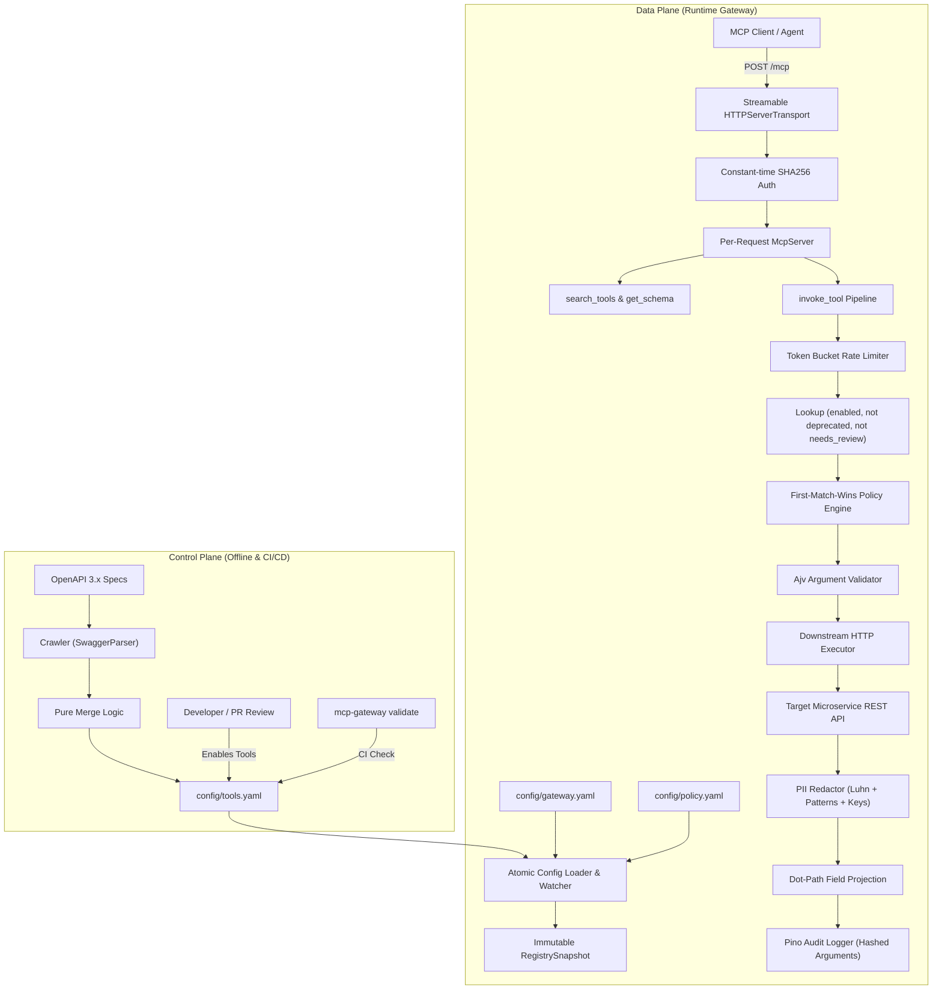

# Architecture & System Design

This document details the system design of `mcp-gateway`, explaining how it implements the principles outlined in Uber Engineering's *"Designing MCP Gateway"* whitepaper and blog post.

---

## 1. Architectural Planes

The system enforces a strict separation between the **Control Plane** (authoring, contract derivation, review, and deployment) and the **Data Plane** (runtime request processing, policy evaluation, execution, and audit). The two planes share only the declarative registry schema.

### The Control Plane
- **OpenAPI Crawler (`src/crawler/openapi.ts`)**: Crawls OpenAPI 3.x specifications via `@apidevtools/swagger-parser`. Derives method, path parameters, query parameters, request bodies, and standard JSON schemas. circular references are pruned to empty objects (`{}`) to guarantee serializability.
- **Risk Categorization (`src/crawler/risk.ts`)**: Automatically maps HTTP methods to risk tiers:
  - `GET`, `HEAD` → `read`
  - `POST`, `PUT`, `PATCH` → `write`
  - `DELETE` → `destructive`
- **Discovery Is Not Exposure (`src/crawler/merge.ts`)**:
  - Newly discovered tools start `enabled: false`.
  - Unchanged tools (identical `source_hash`) preserve human modifications (custom descriptions, owners, `enabled` flags).
  - Modified tools in updated specs have their schema and hash updated, are flagged `needs_review: true`, and are automatically reverted to `enabled: false`.
  - Removed tools are marked `deprecated: true` and disabled.
- **Enrichment (`src/crawler/enrich.ts`)**: Optional AI-assisted generation of agent-friendly descriptions using Claude models via Anthropic SDK, executed with bounded concurrency (4 workers).
- **Validation CLI (`src/cli/validate.ts`)**: Runs in CI pipelines to ensure configuration consistency, valid server references, no duplicate IDs, and zero enabled tools with unassigned ownership or unreviewed changes.

### The Data Plane
- **Hot-Reloading Registry Loader (`src/registry/loader.ts`)**: Reads and interpolates environment variables (`${VAR:-default}`). Reloads are **atomic**: the entire directory is validated using Zod schemas before swapping; if any file is invalid, the existing snapshot is retained.
- **Stateless Per-Request Server (`src/gateway/createGateway.ts`, `src/gateway/mcpServer.ts`)**: For each incoming HTTP request, creates a fresh `McpServer` and `StreamableHTTPServerTransport`, isolates caller context, executes the request, and cleans up upon connection termination.
- **Governed Invocation Pipeline (`src/middleware/pipeline.ts`)**: Applies a deterministic, 9-stage pipeline to every tool call, guaranteeing that exactly one structured audit record is generated for every execution path.

---

## 2. Request Lifecycle (Numbered Stages)

When an agent invokes `invoke_tool` through the gateway, the request passes through the following numbered lifecycle stages:

1. **Transport & Authentication**:
   - The client issues an HTTP POST to `/mcp` with `Authorization: Bearer <token>`.
   - The gateway computes `crypto.timingSafeEqual` over SHA-256 digests of caller tokens to prevent timing attacks.
   - If authentication fails, the gateway immediately returns HTTP `401 Unauthorized` with `WWW-Authenticate: Bearer`.
2. **Rate Limiting**:
   - The token bucket rate limiter (`src/middleware/ratelimit.ts`) checks the caller's allocation based on configured requests-per-minute and burst capacity.
   - If exhausted, an audit log with `decision: rate_limited` is recorded and the request fails immediately.
3. **Tool Lookup & State Check**:
   - The gateway searches `snapshot.tools.tools` for the requested tool ID.
   - The tool must have `enabled: true`, `deprecated: false`, and `needs_review: false`.
   - If any check fails or the tool does not exist, an audit record with `decision: not_found` is written and an identical "Tool not found or not available" error is returned to avoid leaking endpoint existence.
4. **Policy & Scope Evaluation**:
   - The policy engine (`src/middleware/policy.ts`) evaluates rules in ordered, first-match-wins sequence.
   - Checks caller actor type (`human`, `service`, `agent`), tool risk (`read`, `write`, `destructive`), and tool ID glob patterns (`demo.*`).
   - Verifies required OAuth scopes (e.g. `write`, `destructive`). If missing, records `decision: deny` with reason `missing scope: <scope>`.
5. **Argument Schema Validation**:
   - Validates client arguments against the tool's JSON Schema using Ajv (`allErrors: false`, formats enabled).
   - Validators are compiled and cached in-memory by `${tool.id}:${tool.source_hash}` for sub-millisecond execution.
   - If validation fails, logs `decision: invalid_args` and returns the specific schema mismatch error.
6. **Downstream HTTP Execution**:
   - Resolves target microservice base URL from `gatewayConfig.servers[tool.server]`.
   - Encodes path parameters via `encodeURIComponent` and formats query string parameters (supporting array repetition).
   - Dispatches downstream `fetch` wrapped in an `AbortController` timeout (`request_timeout_ms`).
   - Enforces `max_response_bytes` to prevent memory denial-of-service from large payloads.
   - The caller's bearer token is stripped to prevent credential forwarding downstream.
7. **Full Response Redaction**:
   - Before projection or formatting, the entire downstream payload undergoes PII redaction (`src/middleware/redact.ts`).
   - Case-insensitive object keys (e.g. `cardNumber`, `ssn`, `password`) have their values replaced.
   - String values are scanned for emails, phone numbers, SSNs, and credit cards verified by Luhn checksums.
8. **Response Projection**:
   - If the caller provided a `fields` array in `invoke_tool`, `src/gateway/projection.ts` traverses dot paths (e.g. `items.sku`), implicitly mapping across arrays to trim unwanted fields and save context tokens.
9. **Audit Logging & Response Delivery**:
   - Pino logs a structured JSON audit record to `logs/audit.jsonl` with timestamp, caller identity, action, tool, risk tier, decision (`allow`), execution latency, redaction count, HTTP status, and a SHA-256 digest of input arguments (raw values are never persisted).
   - The projected, redacted payload is returned to the agent in standard MCP format.

---

## 3. Mapping to Uber Engineering's Design

| Uber Engineering Design Concept | `mcp-gateway` Implementation | Purpose / Benefit |
| :--- | :--- | :--- |
| **Contract-Driven Tool Generation** | `src/crawler/openapi.ts` | Eliminates manual MCP server authoring; APIs remain source of truth. |
| **Discovery != Exposure** | `src/crawler/merge.ts` + `config/tools.yaml` | All crawled tools default to `enabled: false`. Humans enable via Git PRs. |
| **Change Invalidation & Review** | `source_hash` sha256 checksums | Upstream schema changes disable the tool and trigger `needs_review: true`. |
| **Token-Efficient Progressive Discovery** | `search_tools` + `get_schema` | Exposes only 3 meta-tools instead of 100+ schemas, reducing catalog tokens by 98.5%. |
| **Centralized Cross-Cutting Governance** | `src/middleware/` | Enforces auth, policy, rate limits, PII masking, and audit uniformly across all APIs. |
| **Stateless Gateway Infrastructure** | `StreamableHTTPServerTransport` | Stateless per-request server instances eliminate session synchronization across nodes. |
| **PII & Data Leakage Prevention** | `src/middleware/redact.ts` | Masks sensitive user data before exposing it to external LLM prompts. |
| **Zero Raw Argument Logging** | `auditLogger.hashArgs` | Stores SHA-256 hashes of arguments in audit logs to comply with privacy regulations. |
